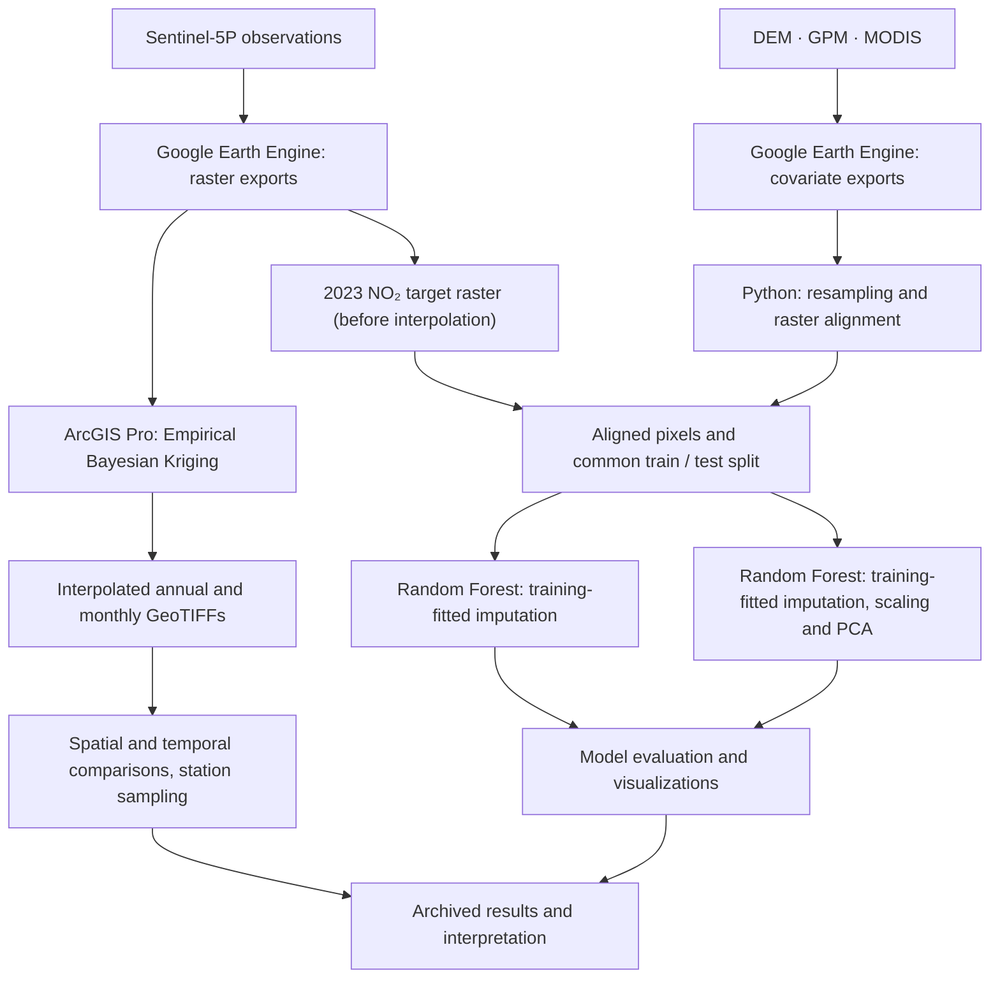
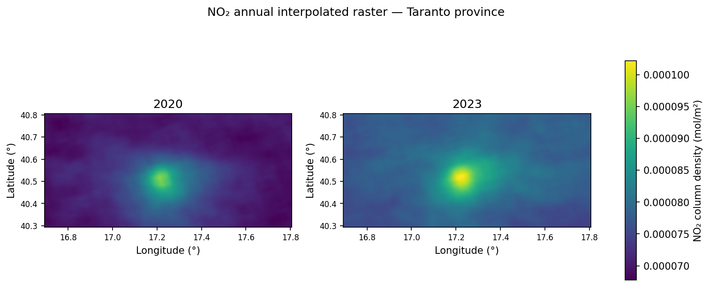
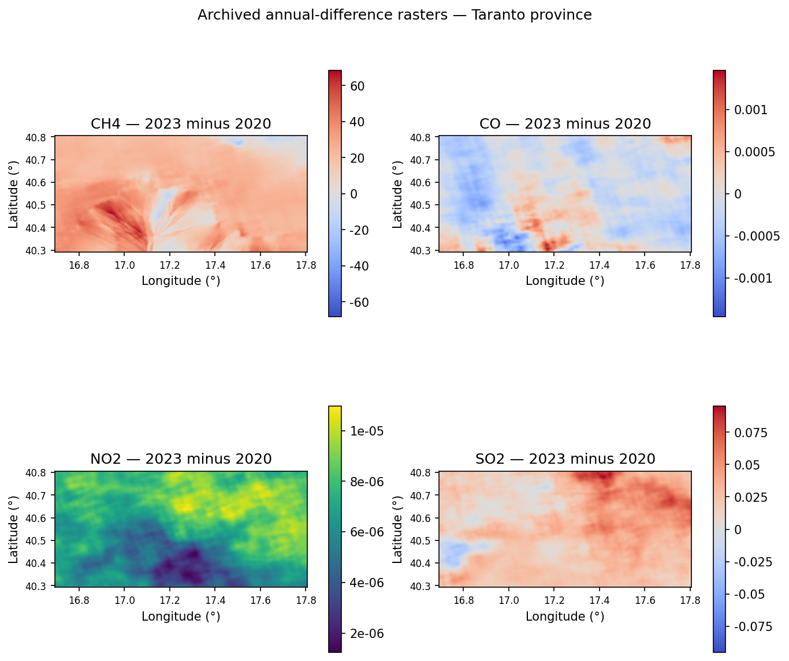

# Assessment of the Environmental Damage Caused by the ILVA Plant in Taranto

Academic image-processing project examining atmospheric-pollutant patterns in the province of Taranto, Italy. The study combines satellite imagery, geographic interpolation, temporal comparisons, reference observations from ARPA Puglia monitoring stations, and exploratory machine-learning experiments.

Developed at **[Politecnico di Bari](https://www.poliba.it/en/laurea-magistrale-ingegneria-informatica)** as part of the **Master's Degree in Computer Engineering**, **Artificial Intelligence and Data Science** curriculum, for the *Computer Vision* course (**Image Processing module**, Academic Year **2023–2024**).

## Objectives and Scope

- Analyze Sentinel-5P observations for **nitrogen dioxide (NO₂), sulfur dioxide (SO₂), carbon monoxide (CO), and methane (CH₄)** in the Taranto area.
- Produce and retain annual satellite-derived raster products for **2020** and **2023**, together with monthly products for **2023**.
- Examine spatial patterns and year-to-year differences using GIS interpolation products.
- Explore monthly trends and values at the coordinates of selected ARPA Puglia monitoring stations.
- Investigate Random Forest regression with elevation, precipitation and land-surface temperature, including a PCA-based alternative.

These are research workflows and exploratory analyses, **not a live air-quality monitoring service** or a source-apportionment model. Satellite atmospheric-column measurements and ground-station concentrations are different quantities and should be interpreted according to their respective units and measurement methods.

## Workflow



The original Earth Engine, ArcGIS Pro and Python stages are documented separately. All archived study rasters and the [complete academic report](docs/academic-report.pdf) can be inspected **without configuring Google Earth Engine or ArcGIS Pro**. The documented ArcGIS processing parameters are summarized in the [GIS workflow](docs/arcgis-workflow.md); an editable ArcGIS project is not included.

## Technology Stack

| Layer | Tools and methods |
| --- | --- |
| Satellite data | Copernicus Sentinel-5P (offline L3 products) |
| Geospatial processing | Google Earth Engine JavaScript API, ArcGIS Pro, GeoTIFF, Rasterio |
| Auxiliary data | Copernicus DEM GLO-30, GPM precipitation, MODIS land surface temperature |
| Data analysis | NumPy, Pandas, SciPy, Scikit-learn |
| Machine learning | Random Forest regression, StandardScaler, mean imputation, PCA |
| Visualization | Earth Engine charts, Matplotlib, Seaborn |

## Archived Geospatial Products

The repository retains **116 GeoTIFF files**: 56 pre-interpolation Sentinel-5P rasters, 56 interpolated rasters and four annual difference rasters. It also contains the original and resampled machine-learning covariates, ARPA station spreadsheets and a station reference workbook. The file names and original raster pixel values are preserved.

### Selected Visualizations



*Annual interpolated NO₂ GeoTIFF previews. Both panels use the same color scale.*



*Direct visualizations of the four archived annual-difference rasters (2023 − 2020). The gases have distinct native units and independent color scales.*

### Annual Comparison Data

The following values are summary statistics of the **archived difference rasters**. Values are expressed in the respective raster's native band units, which differ across pollutants.

| Pollutant | Mean difference: 2023 − 2020 |
| --- | ---: |
| CH₄ | +23.6011 |
| CO | −0.00012013 |
| NO₂ | +0.0000070139 |
| SO₂ | +0.0272911 |

These are descriptive differences between data products; they do not by themselves establish a causal effect of a particular emission source or event.

## Random Forest and PCA Experiment

The Python experiment compares Random Forest regression using the three original spatial covariates (elevation, precipitation and land-surface temperature) with a variant using two principal components. The documented comparison evaluates 1,165 held-out raster pixels (80/20 split, `random_state=42`) using test-set R² and RMSE. These are locally calculated model-evaluation metrics, not historical geospatial measurements. The [experiment notes](results/experimental-results.md) describe the evaluation and the command for generating results from the provided raster inputs.

## Repository Structure

```text
.
├── gee/
│   ├── dependencies/  # Shared Earth Engine functions
│   ├── results/  # Annual, monthly, geographic and station analyses
│   ├── tests/  # Offline JavaScript checks
│   └── *.js  # Satellite and covariate exports
├── python/
│   ├── main.py  # Random Forest/PCA experiment
│   ├── utils.py  # Raster alignment and loading
│   ├── render_maps.py  # Recreate the README maps from GeoTIFF files
│   ├── requirements.txt  # Recorded Python dependency versions
│   └── tests/  # Offline Python tests
├── data/
│   ├── sentinel5p/  # Pre-interpolation and interpolated GeoTIFFs
│   ├── differences/  # 2023 minus 2020 GeoTIFFs
│   ├── covariates/  # Original and resampled covariates
│   ├── arpa/  # Monitoring-station workbooks
│   └── README.md  # Data dictionary and source information
├── results/
│   ├── figures/  # Derived static visual previews
│   └── experimental-results.md
├── docs/  # Methodology, execution notes, references
│   └── academic-report.pdf  # Original 117-page university report
├── .gitattributes  # Git attributes for binary files
└── README.md
```

## Getting Started

### Python

Python **3.12** is recommended. Create a local environment, then install the version-pinned packages originally recorded for the experiment:

```bash
python -m venv .venv
source .venv/bin/activate  # Windows: .venv\Scripts\activate
python -m pip install -r python/requirements.txt
python python/main.py
```

The Python workflow reads the committed, aligned raster inputs and writes plots under `results/generated/`. Generated outputs are not part of the distributed repository; review them before staging changes so only intended files are committed. The pipeline trains and evaluates both model variants using the same 80/20 split (`random_state=42`) and training-only preprocessing.

To regenerate covariate raster resampling without overwriting the original data:

```bash
python python/main.py --resample
```

To rebuild the two geospatial illustrations shown above:

```bash
python python/render_maps.py
```

Additional options, expected data paths and evaluation definitions are documented in [python/README.md](python/README.md).

### Google Earth Engine

These scripts are included as part of the original research implementation. **No Earth Engine account or setup is needed to view the repository, the archived rasters or the report.** To run the Earth Engine stage with your own account, follow the [GEE setup, GeoTIFF asset mapping and execution order](gee/README.md). Its script templates must be set to your own Code Editor module path and Cloud project assets. The Earth Engine Code Editor scripts do not require Node.js or npm.

### ArcGIS Pro

All archived interpolated GeoTIFFs are supplied directly. They can be examined without ArcGIS Pro. The [methodology](docs/methodology.md), the [ArcGIS workflow notes](docs/arcgis-workflow.md) and the [academic report](docs/academic-report.pdf) explain the recorded processing steps. The report records the selected **Empirical Bayesian Kriging** workflow and several tool parameters; the [ArcGIS notes](docs/arcgis-workflow.md) provide the available settings and distinguish them from settings that were not archived. Exact byte-for-byte regeneration is not guaranteed.

## Tests

The Python tests use the Python environment described above. **Node.js is optional and required only for the offline JavaScript tests**; it is not needed for the Python workflows or Earth Engine Code Editor scripts. The JavaScript tests use built-in Node.js modules, so no npm packages or `npm install` step are required.

```bash
python -m unittest discover -s python/tests -v
node gee/tests/test_date_windows.js
node gee/tests/test_scripts.js
```

Offline test coverage includes raster-grid consistency, pixel pairing, unit-level metric checks, model configuration and Earth Engine script parameter generation. Hosted Earth Engine operations and interactive ArcGIS interpolation require their respective external environments. Further details are in [reproducibility.md](docs/reproducibility.md).

## Documentation

- [Full academic report (English, PDF, 117 pages)](docs/academic-report.pdf) — *Assessment of the Environmental Damage Caused by the ILVA Plant in Taranto*. Covers the research context, data, interpolation methods, software and original study findings in detail.
- [Methodology and processing stages](docs/methodology.md)
- [ArcGIS Pro interpolation workflow](docs/arcgis-workflow.md)
- [Data inventory, definitions and attribution](data/README.md)
- [Experimental results and evaluation scope](results/experimental-results.md)
- [Reproducibility and environment setup](docs/reproducibility.md)
- [Reference material and official data portals](docs/references.md)

## Contributors

- [Cosimo Curri](https://github.com/cosimo-curri)
- [Selma Jawhari Idrissi](https://github.com/selmaidrissi16-01)

## License and Third-Party Materials

The original project code is licensed under the [MIT License](LICENSE). Third-party materials remain subject to their respective licenses and terms.

The academic report and repository code originate from a jointly developed university project. Third-party datasets retain their own terms. The archived ARPA spreadsheets were collected for the original study, while the public Regione Puglia 2023 monitoring data are available under **CC BY 4.0**. FAO GAUL 2015 imposes additional conditions on the use of administrative boundaries and derivatives. See [data provenance and usage rights](data/README.md) and [source references](docs/references.md).
